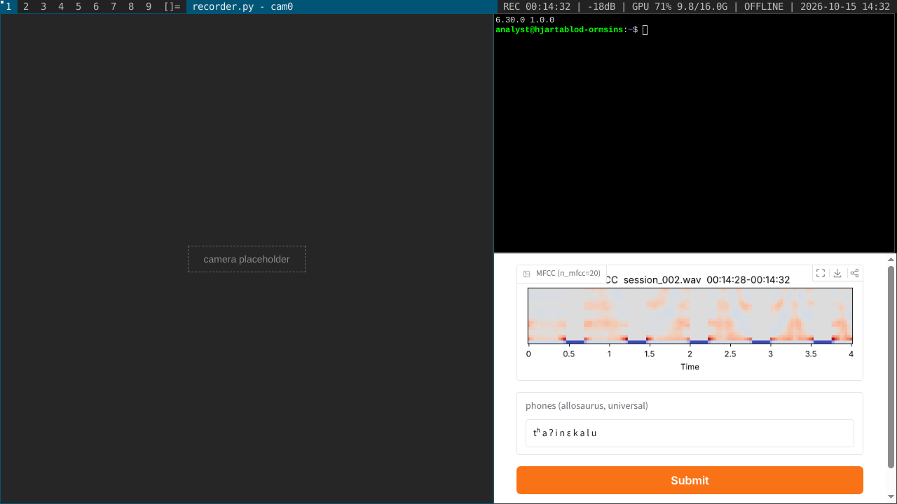
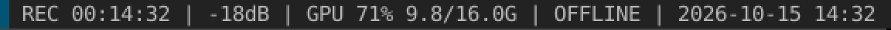
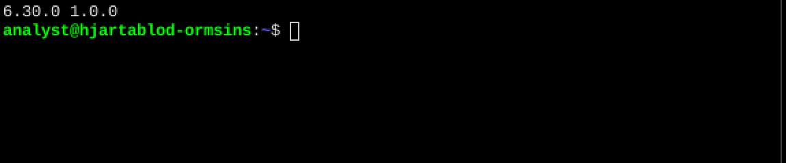
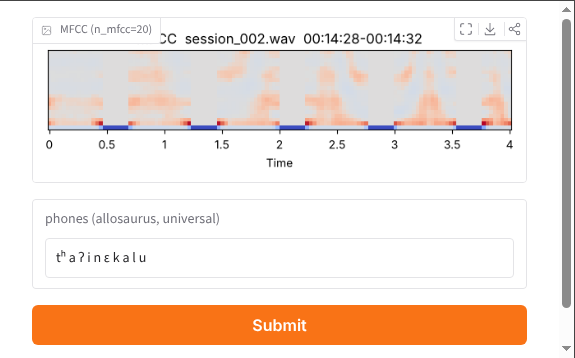

# デザインルール（仮）

画面（作業用の仮想マシン）の見た目のルール。経緯と検討は `ui.md`、マシンの構成は `machine-spec.md`。
迷ったら、この文書のルールと「参考用スクリーンショット」を優先する。

## 0. 前提

- まあまあリアルであること。
- そこまでクールではないこと。無骨な機能美。
- 画面上のすべての文字、色、アイコンには出どころがあること。

## 1. 出どころのルール

画面の要素は、次のどちらかから導く。

1. **そのソフトの初期設定。** 初期値は、定義上クールではなく、定義上リアル。
2. **誰かが変えた理由。** 変更点は少なくし、それぞれの理由を `machine-spec.md` に書く。

出どころを説明できない要素は置かない。

## 2. 窓ごとの見た目

- 窓の中は、その窓のソフトの初期設定で一貫させる。
- 窓どうしの見た目の違い（チグハグさ）は許す。出どころが違うのだから違って当然。
- 層の古さが見た目に出る。土台（dwm、st）は古くて最小。後から USB で届く道具（Gradio）は一番モダン。

| 窓 | ソフト | 見た目の出どころ |
|---|---|---|
| 上端のバー | dwm 6.4 | 初期設定。配色 #222222 / #bbbbbb / #005577 / #eeeeee、書体 `monospace:size=10` |
| 端末 | st | 初期設定。書体 `Liberation Mono:pixelsize=12`、背景は黒 |
| 道具 | Gradio 6（ブラウザのアプリ表示） | 初期テーマ。書体は Gradio が同梱している Source Sans 3（Gradio の設定上の名前は Source Sans Pro）。主ボタンは橙色で横幅いっぱい |
| 録画 | 未定（OpenCV の窓なら、映像の上の文字は Hershey 書体） | 未定 |
| 日本語（仮想マシンの中） | Noto Sans CJK JP（fonts-noto-cjk）。同梱では同じ字形の Noto Sans JP | Ubuntu の日本語書体 |
| 内省（仮想マシンの外） | Noto Serif JP | 記録されないものを、仮想マシンと違う書体で分ける |
| 通信、ノート、UI の日本語（仮想マシンの外） | Noto Sans JP | |

この表が書体の正本。見本のページの説明文に使っている BIZ UD 系の書体は、ゲームの画面には使わない。

## 3. 書体

- **書体はすべて固定する（オーナー）。** 見る側の環境に頼らない。使う書体はすべて同梱し、システムの書体には決して落とさない。
  - 仮想マシンの外の文字（内省の明朝体、UI の日本語）も、Google Fonts から読まずに同梱する（Fontsource などの、文字の範囲ごとに分割された版）。
  - 全角の罫線「──」（U+2500）が途切れずにつながるかは書体に依存する。同梱する日本語の書体で確かめる（Noto CJK 系は JIS の罫線を含むので、つながるはず。確度中）。
  - 台本に出てくる文字が、同梱した書体にすべて含まれているかを、内容の検査で確かめる（予定）。
- 画面は固定解像度（暫定 1280×720）で組み、文字サイズは整数のピクセルにする。表示は全体を拡大縮小する。
- 同梱するときはライセンスを確認する。予約書体名のある OFL の書体（Liberation、Source など）は、文字を絞るなどの改変をせず、元のファイルのまま同梱する（改変版を配るには名前を変える必要がある）。一覧は `THIRD_PARTY_NOTICES.md`。

## 4. アイコン

- 12×12 の1色のドット絵で自作する。既存のアイコン集は使わない。
- 必要になった機能にだけ付ける。飾りのアイコンは置かない。
- ただし、実在のソフトが初期設定で出すアイコン（Gradio の窓の右上の拡大・保存・共有など）は、そのソフトの一部としてそのまま残す。
- 現在: cam（録画）、mic（音量）、gpu（使用率）、usb（道具の搬入）、netoff（切断）、ear（イヤホン越しの通信）。定義は `mock/src/build.py`。この一覧が正本。

## 5. 色

- 色は、ソフトの初期設定の色と、データ（図、精度のバー）だけ。
- 図の配色も初期設定に従う。librosa は負の値を含むデータ（MFCC など）を coolwarm（青〜白〜赤）で描く（実機で確認済み）。
- 虹色など初期設定以外の配色を使うなら、誰がなぜ変えたかを決める。

## 6. 文字の中身

- 端末やログの文言は、実在のソフトが実際に出すものに合わせる。想像で書かない。
- 例: Gradio 6 の起動時の出力は `* Running on local URL:  http://127.0.0.1:7860` と `* To create a public link, set `share=True` in `launch()`.`（行頭に `* ` が付く。実機で確認済み）。

## 落とし穴のチェックリスト

画面を作ったら、出す前に確認する。

### 出どころ

- [ ] すべての文字、色、アイコンについて、出どころ（初期設定か、変えた理由）を言えるか
- [ ] ログや端末の文言を、実在のソフトの出力と照合したか（想像で書いていないか）
- [ ] 初期設定の値を記憶だけで書いていないか。可能なら実機で確認したか
- [ ] 版の数字（Gradio 6.30、librosa 1.0 など）が設定資料と一致しているか

### 書体

- [ ] 書体を同梱しているか。見る側の環境の書体に落ちていないか（Mac、Windows、スマホで確認）
- [ ] 文字サイズが整数のピクセルか
- [ ] 日本語の書体の英字が、端末やバーに混ざっていないか
- [ ] 同梱した書体のライセンスを確認したか

### AI の手癖（Claude が出しがちなもの）

- [ ] 紫から青へのグラデーション、すりガラス風の半透明、全体に角丸と柔らかい影を使っていないか
- [ ] 絵文字をアイコン代わりにしていないか。モダンなウェブ風の線画アイコン集を使っていないか
- [ ] ネオン緑の「ハッカー」風の文字、ACCESS GRANTED、意味のない16進数の羅列を出していないか
- [ ] 何も表していない「ANALYZING...」や、実体のない進捗表示を出していないか
- [ ] 何でも中央寄せ、何でも大文字の等幅ラベルにしていないか
- [ ] 根拠なく Inter や Roboto を使っていないか

### 整合性

- [ ] 窓の中の見た目が、その窓のソフトの中で一貫しているか
- [ ] フォーカス中の窓が1つだけ強調されているか（dwm は枠線の色とバーの題名で示す）
- [ ] 時刻、タイムコード、録音のファイル名など、複数の窓に出る値が互いに矛盾していないか
- [ ] ホスト名 `hjartablod-ormsins`、ユーザー名（仮 `analyst`）がすべての場所で一致しているか

## 参考用スクリーンショット

実物の dwm 6.4、st、Gradio 6.30 を Ubuntu 24.04 の仮想画面（Xvfb、1280×720）で動かして撮影した。
カメラの窓だけは仮の画面。ステータスバーの文字は `xsetroot -name` で設定した仮の内容。
撮影に使った Gradio のアプリは `mock/src/ref-gradio-app.py`。

### 全体

### 見本（mock）との違いとして分かったこと

- **dwm のバーの文字は、見本より大きい。** 高さは約20px。
- **窓のあるタグには、左上に小さな四角が付く。** 見本では抜けていた。
- **ステータスバーは、初期設定ではただの文字列。** アイコンは付かない。アイコンを付けるなら、エンジニアがステータスを出すスクリプトを書いた、という理由が要る。
- **Gradio 6 の主ボタンは横幅いっぱいの大きな橙色。** 見本の小さなボタンは間違い。
- **Gradio はオフラインでも、同梱の Source Sans Pro で表示される。** 見本の「既定の書体に落ちる」は間違い。
- **Gradio の起動時の出力には行頭に `* ` が付く。**
- **dwm はマウスのある窓にフォーカスが移る。** フォーカスしていない端末のカーソルは中抜きの四角になる。

### 拡大（2倍、補間なし）

バーの左側（タグ、配置の記号、フォーカス中の窓の題名）:

バーの右側（ステータス）:

端末（st、Liberation Mono 12px）:

### Gradio 6 の初期テーマ

